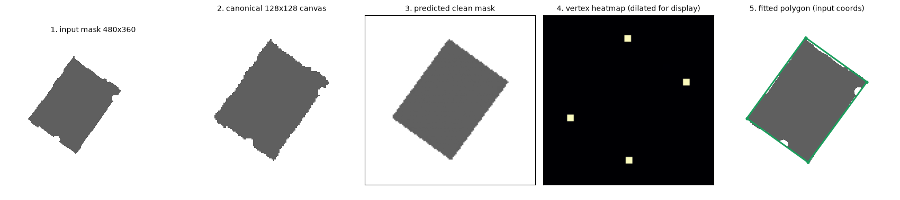
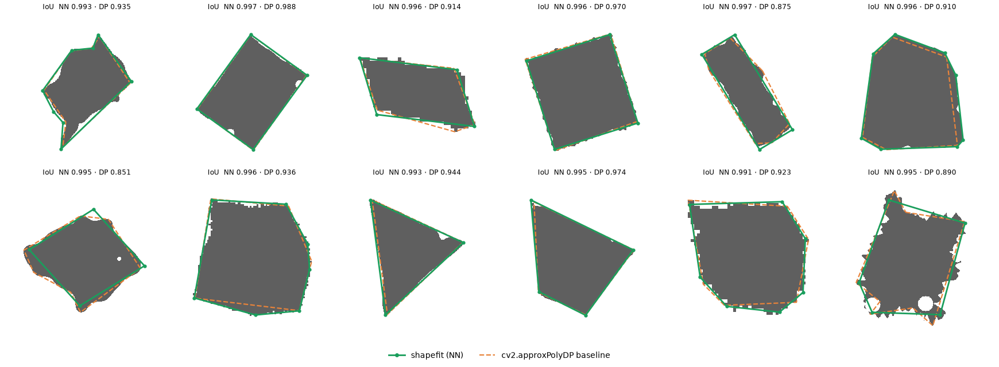
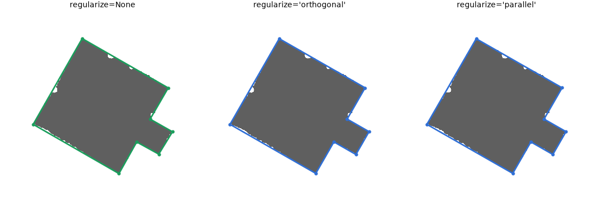
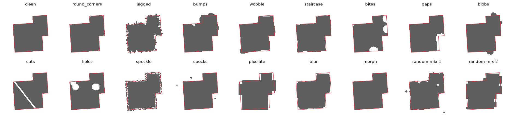
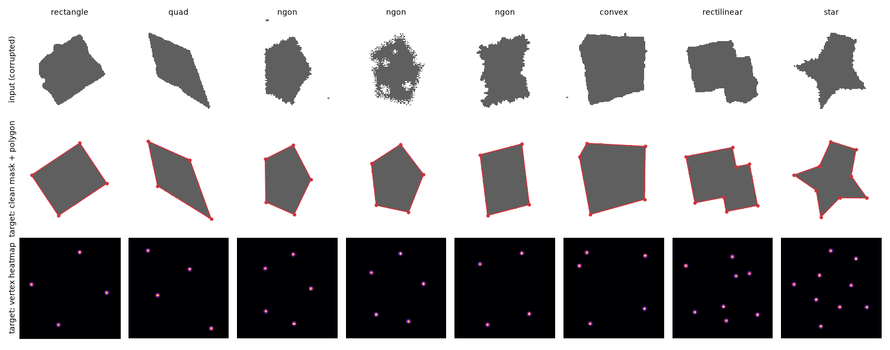

# shapefit

**Fit clean polygons to irregular shapes with a neural network.**

Segmentation masks, scanned drawings, hand-traced regions and noisy GIS
footprints all describe shapes that are *meant* to be polygons. What you get
instead has bumps, jagged edges, notches, gaps, holes and rounded corners.
Classical simplification (`cv2.approxPolyDP`, Douglas–Peucker, convex hulls)
only *removes* points. It can't tell a bump from a corner, so it either keeps
the noise or cuts the corners off.

`shapefit` *learns* the inverse of the corruption instead. The idea is simple:
clean polygons are trivial to generate, and so are the ways real shapes get
damaged. That gives unlimited `(irregular shape → clean polygon)` training pairs
for free.

```python
from shapefit import ShapeFitter

fitter = ShapeFitter("shapefit/weights/shapefit.pt")
polygon = fitter.fit(mask)          # (N, 2) array of (x, y) vertices
```



> [!IMPORTANT]
> **Status:** the data pipeline, model, vectoriser, API and training script
> are complete and tested. The only checkpoint shipped,
> `shapefit/weights/overfit_demo.pt`, was deliberately **overfit on 48 scenes**
> to show the whole pipeline working end to end. It memorises those shapes and
> does *not* generalise. The figures and the first table below use those 48
> scenes. A general model needs one full training run, which is a single
> command; see [Training](#training).

---

## Contents

- [How it works](#how-it-works)
- [Installation](#installation)
- [Usage](#usage)
- [Results (overfit demo)](#results-overfit-demo)
- [Training data](#training-data)
- [Training](#training)
- [Library layout](#library-layout)
- [Limitations and next steps](#limitations-and-next-steps)

## How it works

```
 any-resolution mask      canonical canvas          U-Net (7.8M)               vectoriser                 polygon
 or noisy vertex list ──▶ 128×128, bbox at 72% ──▶ ├─ clean-mask logits ──▶ contour (4× upsampled) ──┐
                          (frame.py)              └─ vertex heatmap     ──▶ peaks → snap to contour ─┤
                                                                            order by arclength        │
                                                                            TLS line per edge  ◀──────┘
                                                                            intersect neighbours
                                                                            (optional angle snapping) ──▶ map back to input coords
```

1. **Canonical framing.** The input (a binary mask of any size, an `(N, 2)`
   vertex list, or a shapely `Polygon`) is cropped to its bounding box, then
   scaled so the long side covers 72 % of a 128×128 canvas. Tiny distractor
   specks are ignored when computing the frame. Training samples are framed the
   same way, from the *corrupted* outline.
2. **Two-headed U-Net.** It sees the mask plus two CoordConv channels and
   predicts:
   - the **clean mask** (BCE + Dice), which says *where the boundary really is*
   - a **vertex heatmap** (CenterNet focal loss), which says *where the corners are*
3. **Vectorisation, with no learned ordering.** Heatmap peaks are snapped to
   the contour of the predicted clean mask. Sorting them by arclength gives the
   vertex order for free, so the network never has to output a variable-length
   sequence. Each edge is then refit with a total-least-squares line through the
   contour points between its two corners (ignoring 15 % at each end).
   Neighbouring lines are intersected. The corners come out *sharp* and
   sub-pixel accurate, even though the heatmap peaks are blurry.
4. **Optional regularisation.** `regularize="orthogonal"` snaps edges to a
   dominant direction or its perpendicular, for buildings and rooms.
   `regularize="parallel"` makes near-parallel edges exactly parallel.

**Why this design?** Predicting vertices directly (set prediction or
autoregressive) has to cope with a variable vertex count and a cyclic,
start-point-free ordering, and it needs far more data and compute. A dense
mask plus heatmap prediction is translation-equivariant, easy to train, and
turns ordering into a 1-D sort. The vectoriser is also a clean upper bound:
fed *perfect* network outputs it reaches **IoU 0.994** with the **exact vertex
count on 100 %** of samples (`tests/test_vectorize.py`). Any remaining error is
the network's.

## Installation

```bash
git clone <this repo> shape-fit && cd shape-fit
pip install -e ".[dev]"      # numpy, torch, opencv-python-headless, shapely, scipy (+ pytest, matplotlib)
pytest                       # 25 tests, ~10 s on CPU
```

## Usage

```python
import numpy as np
from shapefit import ShapeFitter, fit_polygon, iou

fitter = ShapeFitter("path/to/checkpoint.pt", device="cpu")   # or "cuda" / "mps"

# 1. a binary mask of any size (uint8, bool, or float in [0, 1]; RGB(A) is OK too)
poly = fitter.fit(mask)                       # -> (N, 2) float array, (x, y) = (col, row)

# 2. a noisy outline as a vertex list, or a shapely Polygon
poly = fitter.fit(noisy_points)               # (M, 2) array, any units
poly = fitter.fit(shapely_polygon)

# 3. regularisation for man-made shapes
poly = fitter.fit(mask, regularize="orthogonal")   # all edges at 0° / 90° to a dominant axis
poly = fitter.fit(mask, regularize="parallel")     # near-parallel edges made exactly parallel

# 4. test-time augmentation (average of 8 flips/rotations), slower but more robust
poly = fitter.fit(mask, tta=True)

# 5. the intermediate outputs, for debugging and visualisation
r = fitter.fit_detailed(mask)
r.canvas, r.clean_mask, r.vertex_heatmap, r.canvas_polygon, r.frame

# one-shot helper; loads shapefit/weights/shapefit.pt once and caches it
poly = fit_polygon(mask)
```

Vertices are returned counter-clockwise as displayed on screen (x right,
y down), in the input's own pixel coordinates; pixel centres are at integers.
Tuning knobs passed through `fit(...)`: `peak_threshold` (default 0.25; lower
it to recover faint corners) and `min_turn_deg` (default 8°; vertices that turn
less than this are merged).

A runnable version is in [`examples/quickstart.py`](examples/quickstart.py):

```
$ python examples/quickstart.py
4 vertices:
[[184.8  55.5]
 [ 56.1 233.5]
 [190.4 330.5]
 [319.4 153.1]]
IoU vs ground truth: 0.9967
orthogonal fit: 8 vertices, IoU 0.9974
canvas (128, 128) | input->canvas scale 0.333
```

## Results (overfit demo)

The demo checkpoint was trained on the 48 scenes `scene_set(48, seed=7)`.
These are 480×360 masks with one corrupted shape each, at a random position
and scale, passed through the *same* public `fit()` path you'd use. Green is
`shapefit`. Dashed orange is `cv2.approxPolyDP` at 2 % of the perimeter, the
usual default.



Regularisation on a memorised rectilinear scene:



Metrics on the memorised scenes: IoU against the ground-truth polygon,
exact-vertex-count rate, vertex F1 (Hungarian-matched within 3 % of the size),
and median vertex error and Hausdorff distance, both as a fraction of the size.

| method | IoU ↑ | vertex count exact ↑ | vertex F1 @3% ↑ | vertex err ↓ | Hausdorff ↓ |
|---|---|---|---|---|---|
| shapefit (NN) | 0.994 | 100.0% | 0.997 | 0.19% | 0.29% |
| shapefit (NN) + TTA | 0.942 | 8.3% | 0.559 | 2.19% | 3.45% |
| approxPolyDP 1% | 0.924 | 29.2% | 0.558 | 2.25% | 4.91% |
| approxPolyDP 2% | 0.923 | 64.6% | 0.641 | 2.43% | 4.31% |
| approxPolyDP 3% | 0.903 | 64.6% | 0.648 | 2.43% | 5.59% |
| convex hull + DP | 0.906 | 25.0% | 0.582 | 2.50% | 5.04% |
| min-area rectangle | 0.747 | 43.8% | 0.216 | 11.71% | 20.53% |

The TTA row is lower *on purpose*. Seven of the eight flipped or rotated views
are inputs the overfit model has never seen, so averaging them hurts. TTA is
meant for a generally trained model (`tests/test_api.py` checks that the
transforms are undone exactly).

The overfit run hits the vectoriser's oracle ceiling (IoU 0.994, exact
vertex count on 100 % of scenes) at the first evaluation, step 500, which takes
about 2 minutes on an M3 Max. That's the sanity check that the data, targets,
framing and vectoriser all agree.

**And, for honesty, the same overfit model on 200 scenes it has never seen**
(`scene_set(200, seed=999)`):

| method | IoU ↑ | vertex count exact ↑ | vertex F1 @3% ↑ | vertex err ↓ | Hausdorff ↓ |
|---|---|---|---|---|---|
| shapefit (NN) | 0.923 | 0.5% | 0.344 | 3.07% | 5.30% |
| shapefit (NN) + TTA | 0.932 | 3.5% | 0.452 | 2.83% | 4.51% |
| approxPolyDP 1% | 0.911 | 29.0% | 0.552 | 2.66% | 5.52% |
| approxPolyDP 2% | 0.900 | 46.0% | 0.608 | 2.48% | 5.67% |
| approxPolyDP 3% | 0.875 | 47.0% | 0.595 | 2.65% | 7.79% |
| convex hull + DP | 0.888 | 29.0% | 0.583 | 2.82% | 5.78% |
| min-area rectangle | 0.718 | 36.0% | 0.193 | 15.07% | 23.60% |

As expected, memorising 48 shapes doesn't produce a general shape model. The
predicted clean mask still beats every baseline on IoU, but the vertex heatmap
hasn't learned what a corner is, so the vertex count is almost never right.
Closing this gap is exactly what the full training run (millions of fresh
samples instead of 48) is for.

## Training data

Full details are in **[docs/DATA.md](docs/DATA.md)**. The short version:

* **6 polygon families:** regular n-gons, rotated rectangles, quads
  (trapezoids, parallelograms, kites), random convex, concave star-shaped, and
  rectilinear building-like L/T/U/+ shapes. All are filtered so that every
  vertex is a real corner: turn ≥ 12°, edges ≥ 6 % of the size, no slivers.
* **15 named corruptions.** Geometric ones displace a dense outline along its
  normal: jagged, bumps/dents, wobble, staircase, rounded corners. Raster ones
  act on the mask: bites, edge gaps, attached blobs, cuts, holes, speckle,
  distractor specks, pixelation, blur-threshold, morphology. A per-sample
  severity scales them all.



Training pairs: input, clean target with polygon, and vertex heatmap target:



## Training

```bash
# the full run: infinite on-the-fly synthetic data (recommended)
python -m shapefit.train --steps 30000 --batch 64 --out runs/base
cp runs/base/best.pt shapefit/weights/shapefit.pt

# or pre-generate a fixed, shareable dataset (bit-packed .npz shards, ~80 MB per 200k samples)
python -m shapefit.make_dataset --n 200000 --out data/train
python -m shapefit.train --data data/train --steps 30000 --out runs/shards

# reproduce the demo checkpoint (about 10 min on an M3 Max), then shrink it to fp16
python -m shapefit.train --overfit 48 --batch 32 --steps 2500 --eval-every 500 --out runs/overfit
python examples/export_weights.py runs/overfit/best.pt shapefit/weights/overfit_demo.pt

# regenerate every figure and table in this README
python examples/make_readme_figures.py --weights shapefit/weights/overfit_demo.pt
```

The trainer picks CUDA, then MPS, then CPU. It logs the validation metrics
above to `runs/*/log.jsonl` and keeps `best.pt` and `last.pt`. Expect about
0.4 s/step at batch 64 on an M3 Max, so roughly 3.5 h for 30k steps; a CUDA GPU
is several times faster.

## Library layout

| module | contents |
|---|---|
| `shapefit/shapes.py` | clean polygon families and validity rules |
| `shapefit/degrade.py` | the `GEOMETRIC` and `RASTER` corruption registries |
| `shapefit/data.py` | rendering, heatmaps, `make_sample`, `SyntheticShapes` stream |
| `shapefit/scenes.py` | full-resolution test scenes run through the public API |
| `shapefit/make_dataset.py` | shard writer and `ShardDataset` |
| `shapefit/frame.py` | mapping any input to and from the 128×128 canvas |
| `shapefit/model.py` | `ShapeFitNet` U-Net and its losses |
| `shapefit/vectorize.py` | network outputs → polygon; angle regularisation |
| `shapefit/fit.py` | `ShapeFitter`, `fit_polygon`, `FitResult` |
| `shapefit/metrics.py` | IoU, Hausdorff, Hungarian vertex matching |
| `shapefit/baselines.py` | Douglas–Peucker, convex hull, min-area rectangle |
| `shapefit/train.py` | training CLI (stream / shards / overfit) |

## Limitations and next steps

* **No general checkpoint yet.** Run the full training (above). The data,
  loss and vectoriser are already validated by the overfit run and the oracle
  tests.
* **One outer ring per call.** Holes in the *target* polygon aren't modelled;
  holes in the input are treated as noise. For several objects, split the mask
  into connected components and call `fit` on each.
* **Resolution:** corners are localised on a 128 px canvas, then refined to
  sub-pixel accuracy by line fitting. For very large shapes with fine detail,
  a 256 px variant (`ShapeFitNet` and `SIZE`) is a straightforward change.
* **Curves aren't polygons.** Circles and ellipses get approximated by many
  vertices, or by ambiguous ones.
* Next ideas: a vertex-count/confidence output, curved-edge primitives (arcs),
  a multi-ring version for polygons with holes, and real-data fine-tuning (for
  example, building footprints from segmentation).

## License

MIT
