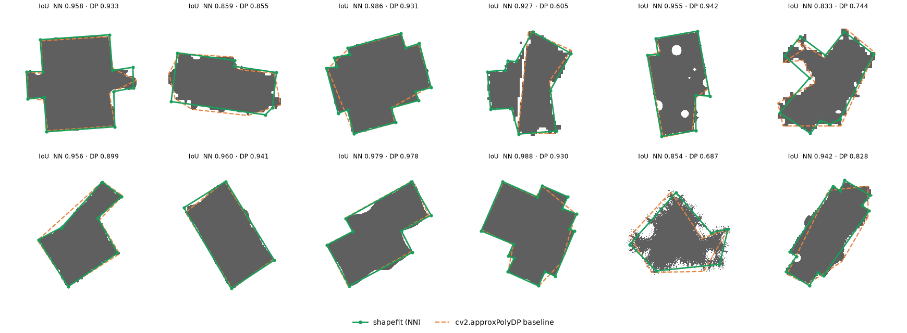

# shapefit

**Fit clean polygons to irregular shapes with a neural network.**

📖 **[Read the illustrated explainer](https://claude.ai/artifact/TQyf1TVKUrR8SDPAA9RXfq)**: how it works step by step, with diagrams and a glossary (also in [`docs/explainer.html`](docs/explainer.html)).

Many shapes must be polygons. Examples are building outlines from aerial
photos, rooms in scanned floor plans, and parts in drawings. But the data
often shows these shapes with bad edges: bumps, jagged steps, gaps, holes and
rounded corners.

The usual tool is Douglas–Peucker simplification (`cv2.approxPolyDP`). It can
only remove points from the outline. It cannot tell a bump from a corner. Thus
it keeps the bumps, or it cuts off the real corners.

shapefit uses a different method. It is easy to make a clean polygon and then
damage it. This gives an unlimited number of training pairs: a damaged shape
and its correct clean polygon. A neural network learns from these pairs to
remove the damage.

```python
from shapefit import ShapeFitter

fitter = ShapeFitter("shapefit/weights/shapefit.pt")
polygon = fitter.fit(mask)          # (N, 2) array of (x, y) corners
```


It also handles shapes that are the **union of several overlapping
rectangles** (building footprints, room layouts), with up to about 20 corners,
whether the rectangles share one orientation or not.

**Results on shapes that the network never saw** (500 shapes of all types, and 200 more unions of rectangles; details in [Results](#results)):

| | IoU ↑ | correct number of corners ↑ | vertex F1 ↑ |
|---|---|---|---|
| **shapefit** | **0.960** | **78.8 %** | **0.845** |
| `cv2.approxPolyDP` (best of ε = 1, 2, 3 % in each column) | 0.910 | 50.6 % | 0.617 |
| **shapefit, unions of rectangles** | **0.947** | **67.0 %** | **0.818** |
| `cv2.approxPolyDP` ε = 1 % (the best setting), unions | 0.898 | 28.0 % | 0.588 |

---

## Contents

- [Terms](#terms)
- [How it works](#how-it-works)
- [Installation](#installation)
- [Usage](#usage)
- [Results](#results)
- [Training data](#training-data)
- [Training](#training)
- [Library layout](#library-layout)
- [Limits and next steps](#limits-and-next-steps)

## Terms

Each term has one meaning in this document. The
[explainer](docs/explainer.html#glossary) has a full glossary.

| Term | Meaning |
|---|---|
| **mask** | An image where each pixel is 1 (inside the shape) or 0 (outside the shape). |
| **corner** | A point where two edges of a polygon meet. The code calls it a *vertex*. |
| **canvas** | The fixed 128 × 128 image that the network always uses. |
| **heatmap** | An image where a high pixel value means "a corner is probably here". |
| **contour** | The outer edge of a mask, as a closed chain of points in order. |
| **vectoriser** | The part of shapefit that changes the network output images into a list of corners. |
| **checkpoint** | A file that contains the trained network weights. |
| **IoU** | Overlap area of two shapes divided by the area that either shape covers. 1.0 means identical. |

## How it works

```
 mask of any size,       canvas                    U-Net (7.8 M weights)       vectoriser                  polygon
 or noisy point list ──▶ 128×128, box at 72 % ──▶ ├─ clean mask      ──▶ contour (4× larger) ───────┐
                         (frame.py)               └─ corner heatmap  ──▶ peaks → put on contour ────┤
                                                                           sort by position          │
                                                                           add missed corners        │
                                                                           fit one line per edge ◀───┘
                                                                           intersect the lines
                                                                           (optional angle rule) ──▶ move back to input coordinates
```

1. **Framing.** shapefit finds the bounding box of the input. The input can be
   a mask of any size, an `(N, 2)` list of points, or a shapely `Polygon`.
   shapefit scales the shape so that the longest side of the box is 72 % of a
   128 × 128 canvas. It ignores very small dots. The training data uses the
   same framing.
2. **The network.** A U-Net looks at the canvas. It makes two images:
   - a **clean mask**, which shows where the true edge is;
   - a **corner heatmap**, which shows where the corners are.
3. **The vectoriser.** This step uses geometry, not learning.
   1. Find the contour of the clean mask.
   2. Find the peaks of the heatmap. Move each peak onto the contour.
   3. Sort the corners by their position along the contour. This gives the
      correct order around the shape.
   4. Add corners that the heatmap missed: where the contour goes more than
      3 canvas pixels from the straight line between two corners, the farthest
      contour point becomes a new corner.
   5. For each edge, fit a straight line through the contour points between its
      two corners. Ignore 15 % of the points at each end.
   6. Each corner is the point where the lines of its two edges cross. The
      result is a sharp corner, with an accuracy better than one pixel.
4. **Regularisation (optional).** `regularize="orthogonal"` makes all corners
   90°. Use it for buildings and rooms. `regularize="parallel"` makes edges that
   are almost parallel exactly parallel.

**Why two images and not a list of corners?** A list has a different length
for each shape, and it has no fixed start point. These facts make a list
difficult to learn. Two images are easier to learn. The sort in step 3 then
gives the order.

**Upper limit.** We gave the vectoriser perfect network outputs. It then gets
**IoU 0.995** and the **correct number of corners on 99.7 %** of shapes (IoU
0.993 and 100 % on unions of rectangles; `tests/test_vectorize.py`). Thus
nearly all remaining error comes from the network.

## Installation

```bash
git clone <this repo> shape-fit && cd shape-fit
pip install -e ".[dev]"      # numpy, torch, opencv-python-headless, shapely, scipy (+ pytest, matplotlib)
pytest                       # 29 tests, approximately 15 s
```

## Usage

```python
import numpy as np
from shapefit import ShapeFitter, fit_polygon, iou

fitter = ShapeFitter("shapefit/weights/shapefit.pt", device="cpu")   # or "cuda" / "mps"

# 1. a mask of any size (uint8, bool, or float from 0 to 1; RGB and RGBA are also accepted)
poly = fitter.fit(mask)                       # -> (N, 2) float array, (x, y) = (column, row)

# 2. a noisy outline as a list of points, or a shapely Polygon
poly = fitter.fit(noisy_points)               # (M, 2) array, any units
poly = fitter.fit(shapely_polygon)

# 3. regularisation for shapes made by people
poly = fitter.fit(mask, regularize="orthogonal")   # all corners 90°
poly = fitter.fit(mask, regularize="parallel")     # almost-parallel edges become parallel

# 4. test-time augmentation: the mean of 8 rotated and flipped copies (slower)
poly = fitter.fit(mask, tta=True)

# 5. the intermediate outputs, to find problems or to make figures
r = fitter.fit_detailed(mask)
r.canvas, r.clean_mask, r.vertex_heatmap, r.canvas_polygon, r.frame

# short form: loads shapefit/weights/shapefit.pt one time and keeps it
poly = fit_polygon(mask)
```

The output corners are in the input pixel coordinates. Pixel centres are at
whole numbers. The corners go counter-clockwise as you see them on the screen
(x to the right, y down).

You can adjust two values in `fit(...)`:

- `peak_threshold` (default 0.25). Make it lower to find weak corners.
- `min_turn_deg` (default 8°). shapefit removes a corner if the direction
  changes by less than this angle.
- `split_tol` (default 3.0 canvas pixels). shapefit adds a corner where the
  outline goes further than this from an edge. `None` turns it off.

[`examples/quickstart.py`](examples/quickstart.py) is a complete example:

```
$ python examples/quickstart.py
6 vertices:
[[ 79.9 130.6]
 [171.6 282. ]
 [286.4 262.1]
 [313.1 140.7]
 [313.1 122.3]
 [293.8  72.9]]
IoU vs ground truth: 0.9677
rectangle union: 10 true corners, fitted 10, IoU 0.9917
canvas (128, 128) | input->canvas scale 0.384
```

## Results

The shipped checkpoint `shapefit/weights/shapefit.pt` is from step 115,000 of
a 120,000-step run (see [Training](#training)). All test shapes come from
seeds that training never used. Each shape is in a 480 × 360 mask, at a random
position and size, and goes through the same public `fit()` function that you
use.

In the figures, the green line is shapefit. The orange dashed line is
`cv2.approxPolyDP` with ε = 2 % of the perimeter, which is a usual setting.


The tables compare each method with the true polygon. They use five metrics:

- **IoU**: the overlap of the output and the true polygon.
- **Vertex count exact**: the percent of shapes with the correct number of corners.
- **Vertex F1**: a score for missed and extra corners. A corner is correct if
  it is within 3 % of the shape size from a true corner.
- **Vertex error**: the median distance from each corner to its true corner,
  as a percent of the shape size.
- **Hausdorff**: the median of the largest distance between the two outlines,
  as a percent of the shape size.

**500 new shapes, all types** (`scene_set(500, seed=999)`):

| method | IoU ↑ | vertex count exact ↑ | vertex F1 @3% ↑ | vertex err ↓ | Hausdorff ↓ |
|---|---|---|---|---|---|
| shapefit (NN) | 0.960 | 78.8% | 0.845 | 1.32% | 2.14% |
| shapefit (NN) + TTA | 0.960 | 77.0% | 0.838 | 1.29% | 2.21% |
| approxPolyDP 1% | 0.910 | 23.6% | 0.541 | 2.71% | 5.76% |
| approxPolyDP 2% | 0.900 | 47.8% | 0.617 | 2.71% | 5.73% |
| approxPolyDP 3% | 0.876 | 50.6% | 0.602 | 2.58% | 7.39% |
| convex hull + DP | 0.891 | 24.6% | 0.581 | 2.81% | 5.56% |
| min-area rectangle | 0.733 | 36.8% | 0.197 | 14.13% | 22.45% |

**200 new unions of overlapping rectangles** (`scene_set(200, seed=1000, family="rect_union")`):

| method | IoU ↑ | vertex count exact ↑ | vertex F1 @3% ↑ | vertex err ↓ | Hausdorff ↓ |
|---|---|---|---|---|---|
| shapefit (NN) | 0.947 | 67.0% | 0.818 | 1.39% | 3.10% |
| shapefit (NN) + TTA | 0.949 | 68.5% | 0.829 | 1.29% | 2.78% |
| approxPolyDP 1% | 0.898 | 28.0% | 0.588 | 2.64% | 5.80% |
| approxPolyDP 2% | 0.880 | 25.5% | 0.578 | 2.67% | 7.08% |
| approxPolyDP 3% | 0.844 | 13.0% | 0.519 | 2.56% | 9.99% |
| convex hull + DP | 0.825 | 9.0% | 0.513 | 4.69% | 15.61% |
| min-area rectangle | 0.690 | 8.0% | 0.106 | 14.34% | 24.94% |



**By shape type** (the same 500 shapes):

| family | n | shapefit IoU | shapefit count exact | shapefit F1 | DP 2% IoU | DP 2% count exact | DP 2% F1 |
|---|---|---|---|---|---|---|---|
| `convex` | 109 | 0.965 | 56.9% | 0.732 | 0.914 | 24.8% | 0.586 |
| `ngon` | 92 | 0.965 | 94.6% | 0.903 | 0.917 | 70.7% | 0.634 |
| `quad` | 65 | 0.951 | 87.7% | 0.828 | 0.891 | 63.1% | 0.641 |
| `rect_union` | 29 | 0.940 | 62.1% | 0.817 | 0.850 | 10.3% | 0.478 |
| `rectangle` | 78 | 0.972 | 93.6% | 0.956 | 0.906 | 71.8% | 0.685 |
| `rectilinear` | 49 | 0.965 | 87.8% | 0.914 | 0.911 | 30.6% | 0.610 |
| `star` | 78 | 0.948 | 69.2% | 0.804 | 0.874 | 41.0% | 0.611 |

**By damage.** The error comes mostly from heavily damaged shapes, where some
corners are not visible in the mask at all. 200 shapes at each fixed severity
(`fixed_set(200, seed=77, severity=s)`, on the 128 × 128 canvas):

| severity | shapefit IoU | shapefit count exact | shapefit F1 | DP 2% IoU | DP 2% count exact | DP 2% F1 |
|---|---|---|---|---|---|---|
| 0.05 (almost clean) | 0.990 | 96 % | 0.989 | 0.955 | 76 % | 0.888 |
| 0.3 | 0.984 | 92 % | 0.974 | 0.947 | 68 % | 0.837 |
| 0.6 | 0.975 | 84 % | 0.918 | 0.933 | 61 % | 0.714 |
| 1.0 (the mean) | 0.959 | 79 % | 0.826 | 0.902 | 48 % | 0.500 |
| 1.5 | 0.937 | 57 % | 0.663 | 0.867 | 28 % | 0.315 |
| 2.0 (the maximum) | 0.913 | 42 % | 0.492 | 0.835 | 17 % | 0.216 |

TTA (8 rotated and flipped copies) changes the results very little. It helps a
little on unions of rectangles and costs 8 times the compute.

Regularisation on a union of rectangles:


## Training data

[docs/DATA.md](docs/DATA.md) gives all the details. In short:

* **7 types of polygon:** regular polygons, rotated rectangles, quads
  (trapezoids, parallelograms, kites), random convex shapes, star shapes,
  L, T, U and + shapes that look like buildings, and unions of 2 to 6
  overlapping rectangles (`rect_union`, 22 % of the data, up to 21 corners). Each corner must turn by 12° or
  more. Each edge must be 6 % of the shape size or longer. Very thin shapes are
  rejected.
* **15 types of damage.** Geometric damage moves the outline in or out: jagged
  edges, bumps and dents, wobble, steps and rounded corners. Pixel damage
  changes the mask directly: bites, gaps, blobs, cuts, holes, speckle, loose
  dots, pixelation, blur and morphology. A random value called *severity*
  controls how strong the damage is.


Training pairs. Row 1 is the input. Row 2 is the clean target with the true
polygon. Row 3 is the target heatmap.


## Training

```bash
# the full run, with new data for each step (this made the shipped checkpoint)
python -m shapefit.train --steps 120000 --batch 64 --workers 28 --eval-every 5000 --out runs/full
python examples/export_weights.py runs/full/best.pt shapefit/weights/shapefit.pt   # fp16, 15 MB

# or: write a fixed dataset to disk first (approximately 80 MB for 200,000 shapes)
python -m shapefit.make_dataset --n 200000 --out data/train
python -m shapefit.train --data data/train --steps 30000 --out runs/shards

# make all figures and tables in this README again
python examples/make_readme_figures.py --device cuda
python examples/make_explainer_figures.py
```

The training script uses a CUDA GPU if there is one. If not, it uses the
Apple GPU (MPS). If neither is available, it uses the CPU. On CUDA it uses
bf16 autocast and `torch.compile` (`--no-amp`, `--no-compile` turn them off).

Every `--eval-every` steps, the script measures the five metrics on 500 test
shapes and on 200 unions of rectangles (`union_*` keys). It writes them to
`runs/*/log.jsonl`. It keeps the best checkpoint (`best.pt`) and the last
checkpoint (`last.pt`).

We measured the shipped run on one NVIDIA RTX 4090 (WSL2, 32 CPU threads):

| Item | Value |
|---|---|
| One training step (64 shapes), compiled + bf16 | approximately 30 ms |
| Mean time per step, including the 24 checks | 37 ms |
| **120,000 steps (7.7 M shapes)** | **74 min** |
| Data workers | 28 (about 14 ms per batch, so the GPU sets the speed) |

The validation scores grew slowly after approximately 60,000 steps: vertex F1
went from 0.692 (step 5,000) to 0.763 (step 60,000) and 0.780 (step 115,000)
on the main check set.

> [!CAUTION]
> The training script cannot continue a stopped run yet. It saves `last.pt`
> at each check, but after a crash you must start again.

## Library layout

| module | contents |
|---|---|
| `shapefit/shapes.py` | the polygon types (including `rect_union`) and the rules for a valid polygon |
| `shapefit/degrade.py` | the damage types (`GEOMETRIC` and `RASTER`) |
| `shapefit/data.py` | drawing, heatmaps, `make_sample`, the `SyntheticShapes` data stream |
| `shapefit/scenes.py` | full-size test images that use the public API |
| `shapefit/make_dataset.py` | writes a fixed dataset to disk; `ShardDataset` reads it |
| `shapefit/frame.py` | moves any input to the 128 × 128 canvas and back |
| `shapefit/model.py` | the `ShapeFitNet` U-Net and its loss functions |
| `shapefit/vectorize.py` | changes network outputs into a polygon; regularisation |
| `shapefit/fit.py` | `ShapeFitter`, `fit_polygon`, `FitResult` |
| `shapefit/metrics.py` | IoU, Hausdorff distance, corner matching |
| `shapefit/baselines.py` | Douglas–Peucker, convex hull, minimum-area rectangle |
| `shapefit/train.py` | the training command (data stream, dataset on disk, or the `--overfit` sanity check) |

## Limits and next steps

* **Heavy damage.** At the highest severity, shapefit finds the correct number
  of corners on 42 % of shapes. Some corners are not visible in such masks at all.
* **Small steps.** On a union of many rectangles, a step shorter than about 3 %
  of the shape size can disappear.
* **One outer edge for each call.** shapefit does not make polygons with
  holes. It ignores holes in the input, as noise. For many shapes in one mask,
  split the mask into connected components. Then call `fit` for each one.
* **Resolution.** The network finds corners on a 128-pixel canvas. The line
  fit then gives an accuracy better than one pixel. Very small details on a
  very large shape can disappear. A 256-pixel version is a small change
  (`ShapeFitNet` and `SIZE`).
* **Curves are not polygons.** A circle or an ellipse gets many corners, or
  corners that are not clear.
* **Possible next work:** an output for the number of corners and for
  confidence, edges that are arcs, polygons with holes, and more training on
  real data (for example, building outlines).

## License

MIT
